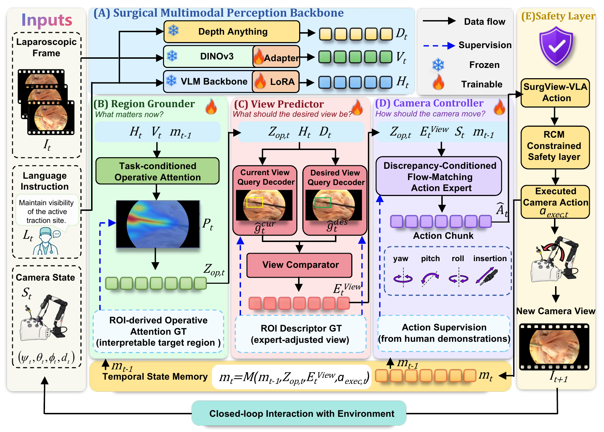

# SurgView-VLA

**Task-Grounded View-to-Action Learning for Autonomous Laparoscopic Camera Control**

This repository provides an initial, partial release of selected method components for SurgView-VLA, submitted to IPCAI 2027.

> **Release status:** Core method preview. The complete codebase, training configurations, and reproduction instructions will be released as soon as possible.

## Overview

SurgView-VLA studies task-conditioned camera control through three questions: **what to observe, how the current view should change, and what camera motion to generate**.



[View the original architecture figure (PDF)](assets/figure03.pdf)

The figure shows the overall framework: **(A) Surgical Multimodal Perception Backbone**, **(B) Region Grounder**, **(C) View Predictor**, **(D) Camera Controller**, and **(E) Safety Layer**, with **Temporal State Memory** supporting closed-loop interaction.

This preview provides selected feature-level implementations of **(B)-(D)**. The perception backbone, temporal-memory integration, and RCM-constrained execution layer shown in the figure are outside the current release.

## Included components

| Component in the figure | Python class | What is released |
| --- | --- | --- |
| **(B) Region Grounder** | `RegionGrounder` | Task-conditioned operative attention via semantic FiLM modulation, attention and visibility prediction, and visibility-gated attention pooling into `z_op`. |
| **(C) View Predictor** | `ViewPredictor` | Current and desired view query decoders, four-dimensional view regression, shared de-normalization, and a view comparator computing `g_des - g_cur`. |
| **(C) View Predictor — optional scale-residual variant** | `ScaleResidualViewPredictor` | A frozen base View Predictor with a gated residual for the desired scale coordinate. This is a variant of (C), not an additional framework component. |
| **(D) Camera Controller** | `CameraController` | A discrepancy-conditioned flow-matching action expert that generates 8-step camera action chunks using zero-initialized, 32-step Euler sampling; an MLP alternative is also available. |

These are selected implementations extracted from the research code. Public class names and module filenames follow the figure. Packaging and explanatory comments have been adjusted; the model computations have not been changed. They do not constitute a complete release of every component described in the manuscript.

## Feature and action interfaces

The included view modules use the following default interfaces:

| Tensor | Shape | Meaning |
| --- | --- | --- |
| `h_t` | `[B, 4096]` | Task-conditioned semantic feature. |
| `v_t` | `[B, 14, 24, 1024]` | Spatial visual feature grid. |
| `depth_t` | `[B, 45, 80]` | Relative depth map, not metric depth. |
| `attention` | `[B, 45, 80]` | Predicted operative attention. |
| `z_op` | `[B, 1024]` | Attention-pooled, visibility-gated visual feature. |
| `g_cur`, `g_des`, `e_view` | `[B, 4]` | Current view, desired view, and their difference. |
| Flow output | `[B, 8, 4]` | Action chunk ordered as yaw, pitch, roll, insertion. |

The manuscript's geometric descriptor is `[c_x, c_y, log(sqrt(area)), d_rel]`. Both view predictions must be brought into the **same descriptor space** before subtraction. The released head provides shared `view_mean` and `view_scale` buffers; dataset statistics and label construction are not included.

Future expert views provide supervision during training. The released `ViewPredictor.forward(h_t, z_op, depth_t)` uses current features only: it predicts the desired view and subtracts the predicted current view. It does not require future frames or expert ROI annotations at inference.

`CameraController` accepts a caller-supplied condition vector. The synthetic example concatenates `z_op`, `e_view`, and a four-dimensional camera state to illustrate the interface. This example does not supply the manuscript's complete temporal context, learned normalization, or perception pipeline.

## Run the synthetic example

Use Python 3.10+ with PyTorch. The modules and checks were exercised on CPU with Python 3.12.14 and PyTorch 2.6.0.

```bash
python -m venv .venv
# Linux/macOS:
source .venv/bin/activate
# Windows PowerShell:
# .venv\Scripts\Activate.ps1
python -m pip install -e .
python -m examples.synthetic_forward
python -m unittest discover -s tests -v
```

The example uses random features and randomly initialized weights. It checks module composition and tensor shapes; it does **not** reproduce experimental results or generate a trained control policy.

## Release scope

Included: the core modules above, a synthetic forward example, and CPU checks for pooling, view subtraction, the optional scale residual, and flow sampling.

Still to be released: the complete training and evaluation pipeline, data preparation and annotation processing, backbone integration, temporal context, model weights, normalization statistics, experiment configurations, and reproduction instructions. Robot calibration and execution integration are also absent from this preview. Action outputs from this package are not ready for execution on hardware.

No experimental scores are claimed for the synthetic example. A license has not yet been specified for this preview.

**The code repository will be completed as soon as possible.**
